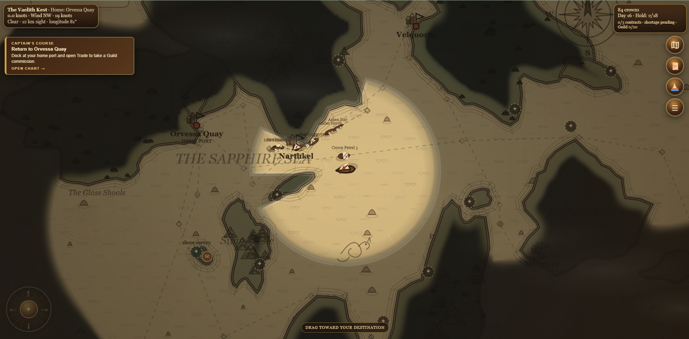
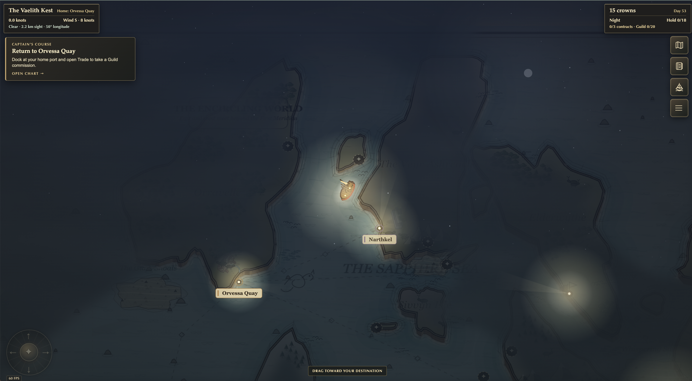

# Parchment Maps

An experiment in AI-assisted game development.

The world renders as a true 3D diorama in WebGL2: the hand-painted chart is
draped over displaced terrain, the sea animates in place, and vessels sail as
low-poly models — all in the same parchment palette. The camera orbits freely:
drag to spin and tilt, scroll to zoom, or use Q/E to spin, R/F to tilt.

