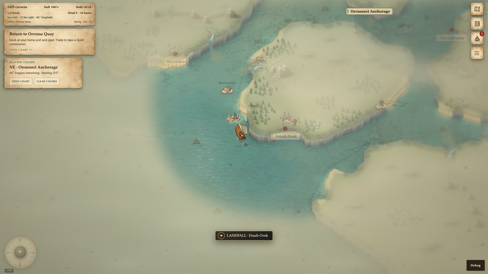
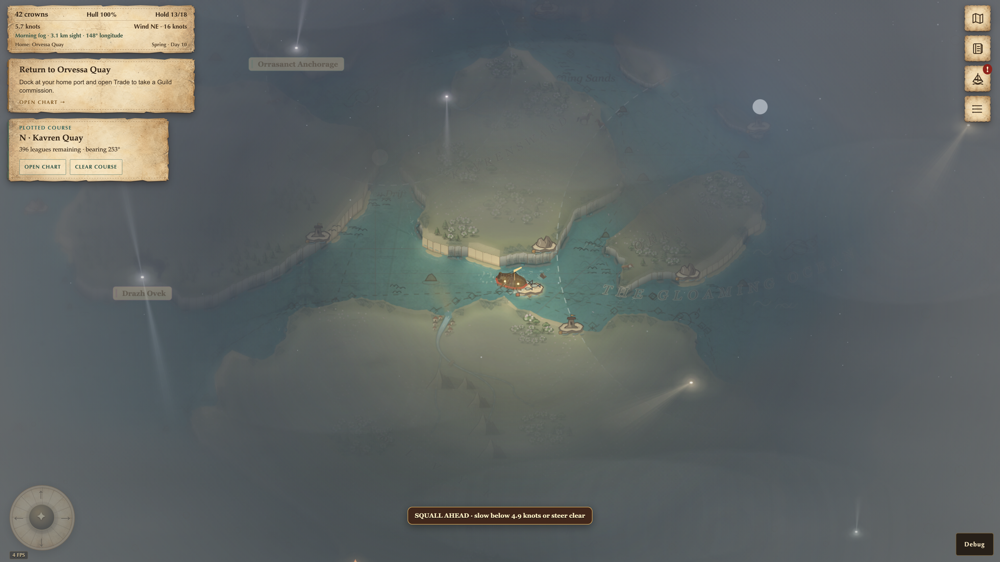
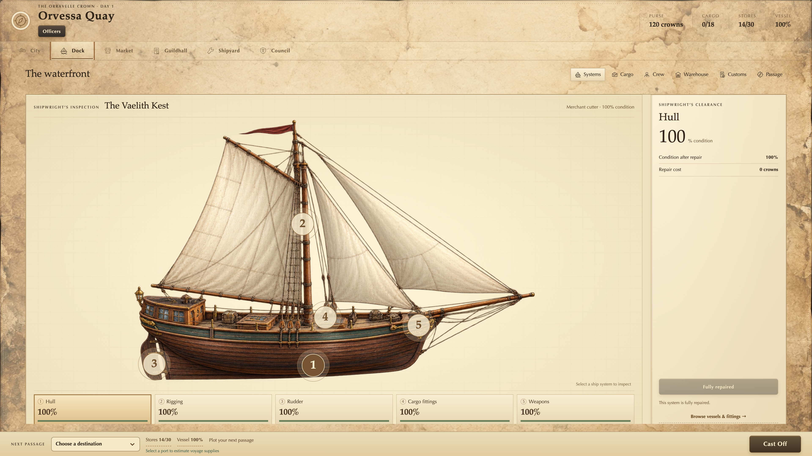

# Parchment Maps

An experiment in AI-assisted game development.

Run a self-playing headless voyage with `npm run automate -- --seconds 180`.
See [automated voyages](./docs/automation.md) for setup, reproducible tuning runs,
the browser control API, and demo recording.

Gameplay screenshots captured at 3840 × 2160 with high graphics quality. Open an
image to view it at full resolution.

Sailing past Drazh Ovek, with a course plotted for Orrasanct Anchorage.

Night sailing through The Gloaming, with lighthouse beams sweeping the coast.

Inspecting the ship’s hull, rigging, rudder, cargo fittings, and weapons at Orvessa
Quay.

